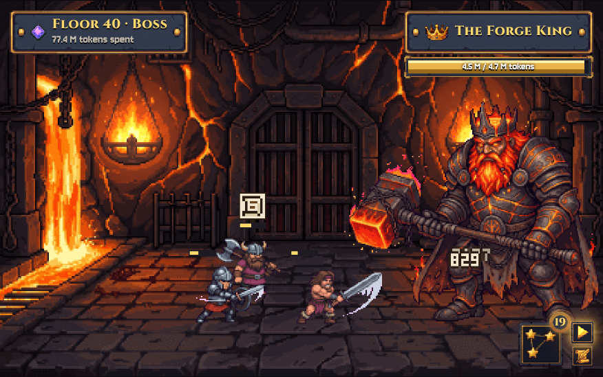
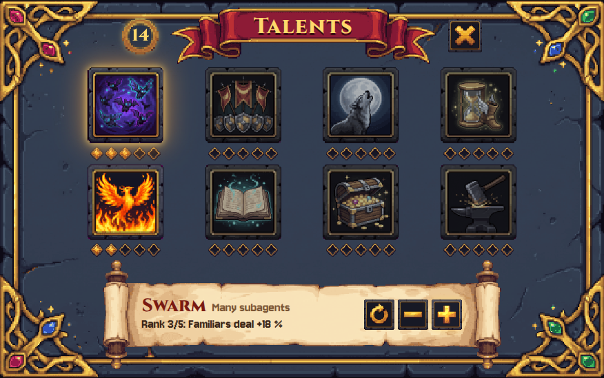

# Rogue Agents

A pixel-art dungeon, 105 floors deep, that your [OpenCode](https://opencode.ai) agents fight through. Every token
they spend strikes the monster in front of them: each active session sends an adventurer into the fight, each subagent
summons a small familiar, and the guild goes deeper as you work.



It plays itself. Now and then you spend talent points on the branches that suit the way you work, and you compare
depths with your colleagues: _"300 M tokens, I'm at the floor 21 boss. You?"_

## Install

Rogue Agents is a GUI plugin for the **OpenCode desktop app**, version 2.3 or later. (Third-party GUI plugins load in
the desktop app only, not in the web UI of `opencode serve`.)

Add it to the `plugins` list of your OpenCode config, `~/.config/opencode/opencode.jsonc`:

```jsonc
{
  "plugins": ["github:clamboley/RogueAgents"],
}
```

Restart the desktop app, then open the dungeon from the command palette (**Open Rogue Agents**) or from a session's
panel menu. To pin a version, use a tag: `"github:clamboley/RogueAgents#v0.1.0"`.

Your guild starts on floor 1: the OpenCode history from before you installed it does not count. From then on, the
work your agents do while the app is closed is caught up when it opens.

## How it plays

- **Floors and biomes.** Each floor holds four monsters and a boss, with health counted in damage. Every ten floors
  the dungeon changes biome (crypts, crystal caves, fungal forest, volcanic forge, abyss, frozen citadel, storm
  peaks, celestial palace, outer space, the void) and ends with a biome boss.
- **Outside the simulation.** Past floor 100 the guild escapes: the dungeon was a simulation, and its makers, alien
  beings in a white hall of flowing curves, send five ultra bosses, one per floor, alone. When the fifth falls, the
  game is won, and the share line says how many days it took.
- **Pace.** Each floor costs 10 % more than the last: about 5 M damage clears the crypts, 900 M the first six biomes,
  41 billion the last one and 67 billion the whole dungeon. For a heavy user of one agent at a time (some 75 M damage
  a day), that is under two weeks for the first six biomes, a year and a half to floor 100, two years to the end.
- **Live damage.** Output and reasoning tokens strike in full while they stream. The context a step reads (input and
  cache) lands as a charged attack when the step ends, at 5 % of its size: an agent reads its whole context again at
  every step, so at full weight it would be the whole game. Nothing depends on whether a task succeeds, only on what
  your agents spend.
- **Talents.** One point every five floors, to spend in eight branches, one per way of working: many subagents, many
  sessions, a single session, long sessions, frequent compactions, heavy reasoning, heavy caching, many tool calls.
  The 20 points cover only half of the tree's 40 ranks, so the tree is a choice; resetting it is free.

  

- **Share** (the quill button) copies a line such as
  `Rogue Agents · Floor 21 (Fungal forest) · 307.6 M tokens · Swarm 5 / Marathon 3`.
- **Demo** (the play button) shows a made-up guild fighting in a random biome, without touching your progress.

The full design, in French, is in [docs/DESIGN.md](docs/DESIGN.md).

## Privacy

The plugin only talks to the OpenCode server inside your desktop app: it listens to session events and reads token
totals. It sends nothing anywhere. Progress is saved in the app's local storage.

## Development

```sh
git clone https://github.com/clamboley/RogueAgents.git
cd RogueAgents
npm install
npm run bundle
```

Point your OpenCode config at the clone instead of GitHub (`"plugins": ["/path/to/RogueAgents"]`) and run
`npm run watch`: the desktop app reloads the plugin on every build.

| Command          | Does                                                    |
| ---------------- | ------------------------------------------------------- |
| `npm run bundle` | Bundles the plugin into `dist/gui-experimental.cjs`.    |
| `npm run watch`  | Rebuilds on every change.                               |
| `npm run check`  | Typecheck, formatting check and unit tests, as CI does. |
| `npm run format` | Formats everything with Prettier.                       |

OpenCode installs plugins from GitHub as they are, without building them, so **`dist/` is committed**: rebuild and
commit it with your changes (CI fails when it is stale). The script is named `bundle` rather than `build` on purpose:
npm treats a git package with a `build` script as one to prepare, which fails inside OpenCode.

### Layout

- `src/gui.tsx`: the plugin: saved store, panel, command, and the connection to the app's server (live events, token
  totals, running sessions).
- `src/game/progress.ts`: the game math: floor costs, where damage stands, talents. Pure functions, unit-tested in
  `test/`.
- `src/game/dungeon.ts`: the engine: the party, live damage, room transitions, the demo, and drawing the scene.
- `src/game/art.ts`, `gfx.ts`, `sprites.ts`: biomes, classes and familiars; sprite drawing and recolouring; small
  hand-drawn icons and a pixel font for the canvas.
- `src/panel.tsx`, `src/styles.css`: the game screen, its painted HUD and the talent menu.
- `src/i18n/`: English and French.
- `src/assets/`: the sprites, generated by the [art pipeline](art/README.md). `src/fonts/`: the fonts.
- `scripts/`: drive a desktop app over the Chrome DevTools Protocol for manual checks and these screenshots (see the
  comments in `scripts/drive.mjs`).

The GUI plugin API is experimental (`./gui-experimental`); a future OpenCode release may require changes.

## Credits and license

- Code: [MIT](LICENSE).
- Art: generated with Google Gemini, then turned into pixel art by the scripts in [`art/`](art/README.md);
  distributed with the code under the same license.
- Fonts: [Cinzel](https://github.com/NDISCOVER/Cinzel) and [Jersey 10](https://github.com/scfried/soft-type-jersey),
  both under the SIL Open Font License 1.1 (licences in `src/fonts/`).
